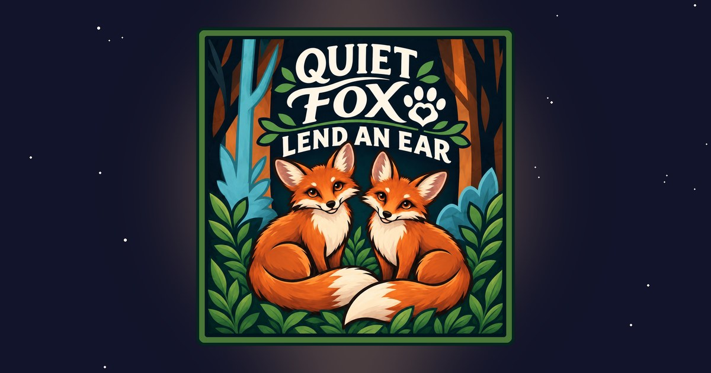

# QuietFox (demo)

**Someone to talk to before you sleep.** QuietFox pairs adults for calm, anonymous, one-on-one voice calls. It's peer support, not therapy.

▶️ **[Try the live demo](https://zachjjames.github.io/quietfox-demo/)**

> This repository hosts the interactive front-end demo. The full application source (back end, signaling and matchmaking) is private.



## Why I built it

I first had the idea in 2020: a lot of people have a rough day and just want someone to talk to before bed, without video, real names or the pressure of a therapy app. In October 2026 I started building it.

## How it works

1. **Join the queue.** A user opens the app and asks to talk. No real name or video needed.
2. **Matchmaking.** The PHP back end pairs two waiting users and stores the match in MariaDB.
3. **Signaling.** The two browsers swap connection details through a REST-style signaling API.
4. **Connect.** WebRTC opens a direct peer-to-peer audio call. STUN/TURN servers handle NAT traversal when users are behind routers or firewalls.
5. **Encrypted call.** Audio is encrypted end to end with DTLS-SRTP and never stored.

```
Browser A ──► PHP API (Apache) ──► MariaDB (queue & matches)
    │              ▲
    │   signaling  │
    ▼              │
Browser B ◄────────┘
    ▲
    └──── WebRTC peer-to-peer audio (DTLS-SRTP) ────► Browser A
           STUN/TURN for NAT traversal
```

## Features

- Anonymous profiles, no real names or video
- Queue-based matchmaking into real-time voice calls
- User settings
- Admin dashboard for moderation
- Always-visible **"Help now"** crisis resource
- 18+ only

## Tech stack

| Layer | Technology |
| --- | --- |
| Front end | HTML, CSS, JavaScript |
| Back end | PHP on Apache |
| Database | MariaDB |
| Real-time audio | WebRTC, STUN/TURN, DTLS-SRTP |
| Hosting (demo) | GitHub Pages |

## Privacy and safety

QuietFox is designed around privacy first: anonymous accounts, no stored audio or video, no real identities, and a crisis resource available on every screen. It's positioned as peer support, not a replacement for professional help.

## Author

**Zachary James** · [GitHub](https://github.com/zachjjames) · [LinkedIn](YOUR-LINKEDIN-URL)

## Copyright

© 2026 Zachary James. All rights reserved. See [LICENSE](LICENSE).
